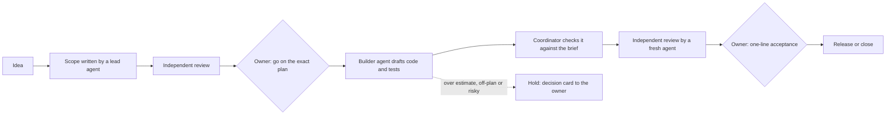

# Agent Dispatch Dashboard (ADD)

**A governed multi-agent AI system: Claude and OpenAI agents working as an accountable team, with a human owner deciding what matters.**

I designed ADD and run it as its product owner. AI agents plan, build and review the work. People approve the decisions that carry risk, and every step leaves a record. This repository is a public overview: the working system and its records stay private because they run real business work.

## The problem

AI agents are fast, but on their own they drift. They skip steps, review their own work, overrun estimates and lose track of what was decided. Passing prompts between chat windows by hand doesn't scale either.

ADD treats agents like a team with clear roles, written plans, independent checks and an owner who signs off. The goal is more work running in parallel, with less hand-holding, and a result I can trust.

## How a piece of work moves

- **Approvals bind to an exact version.** A "go" covers one specific revision of a plan, identified by a content hash. If the plan changes, it needs a new go.
- **No one reviews their own work.** Reviews come from a fresh agent session that didn't write or check the work. Disputed blockers go to judges from two different model providers.
- **Drift comes back to a person.** Work that runs well over its estimate, changes its goal, weakens a test or reaches outside its limits is held automatically and sent to the owner as a decision card.
- **Autonomy is earned.** A kind of work needs less oversight only after 10 accepted results in a row with no problems found afterwards, and with the owner's yes. A single serious miss moves it back automatically.
- **The owner's attention goes to decisions.** A daily digest covers what moved, what's waiting on whom and what stalled. Decisions arrive as short cards.

## What's under the hood

| Layer | What it does |
| --- | --- |
| **Decision records** | Every change records who made it, what changed and why. A repeated request returns its original receipt instead of applying twice, so a crashed agent can retry safely. |
| **Who may do what** | A database authorization layer (PostgreSQL) with rules on every row. Each role sees only its own data and changes it only through fixed, checked commands. A built-in self-check reports any permission or structure problem. |
| **Sealed workspaces** | Each agent run is a capped process with limits on processor, memory, disk, process count and run time, and it can be stopped whole. All of ADD is capped below a fixed share of the machine. |
| **Network wall** | Agents reach the internet only through a proxy that allows approved destinations and can cut a connection mid-run. |
| **Code hand-out** | Agents never touch the real repository. They get a checked, size-limited copy of the files a task needs. Bringing work back is a separate, reviewed step. |
| **Secrets** | Keys and sign-ins never pass through a chat or a document. A person places them directly, and each has a written replacement procedure. |
| **Owner screens** | A web app (Python, Starlette) built around one question: what needs me? Colours and fonts live in one theme file, so the look can change without touching the screens. |

## How I know it works

- **Tests come with every piece.** For example, the first two database pieces passed 2,279 automated checks, including checks that are meant to be refused, such as one role reading another's data.
- **The tests are tested too.** The tests also run against deliberately broken copies of the code (mutation testing), and every planted fault must be caught. Server safety checks are proven the same way: switch one off and confirm the step then refuses.
- **Changes are staged and checked.** Each server change runs as a reviewed script inside an approved time window. It snapshots the protected parts of the server before and after, and it stops itself before changing anything if a check fails. Each database piece ships with an undo that removes exactly that piece. The machine is shared with another business application, and that application always comes first.
- **Approval paths are tested.** For example, a test confirmed that only an answer from the owner's own login counts, and that automated tools can't reach the owner's decision list.

## Where it stands (November 2026)

The first version of ADD, a message-based coordinator for Claude and OpenAI agents, ran across hundreds of recorded conversations for software, research and documentation. It showed that the approach works, and it showed where it needed real controls.

Version 2 rebuilds it as a platform with the controls built in:

| Part | Status |
| --- | --- |
| Server foundation and its safety checks | Done |
| Authorization layer (who may do what) | Done |
| Database pieces (records, people and accounts, settings…) | In progress: first two accepted |
| Runtime core (sealed workspaces, network wall, code hand-out) | In progress: first piece installed |
| Operating rulebook and decision queue (bootstrap version) | In use |
| Owner screens | First version built on sample data |
| Messages, reviews, releases, usage tracking and auditing | Planned, with reviewed plans |
| Switch-over from version 1 | Planned |

## What this project shows

- **AI product ownership:** turning a messy, multi-chat workflow into an operating model with clear roles, decision rights, acceptance criteria and measures (review rounds, time to acceptance, findings, usage by role).
- **Controls you can audit:** separation of duties, least privilege, approvals tied to exact versions, and a full record of every change. These are the habits of regulated industries, applied to AI agents.
- **Multi-model orchestration:** Claude and OpenAI models in defined roles, with cross-checking between them.
- **Quality discipline:** independent review, mutation testing, staged changes and plain-English reporting for non-technical readers.

## Tech

Python (Starlette, Jinja2) · PostgreSQL 18 · Linux service management (systemd) · Claude and Claude Code (Anthropic) · GPT and Codex (OpenAI) · GitHub · Notion

---

Built by Aaron, a data and analytics professional with a background in financial services, working on AI-run product development.
