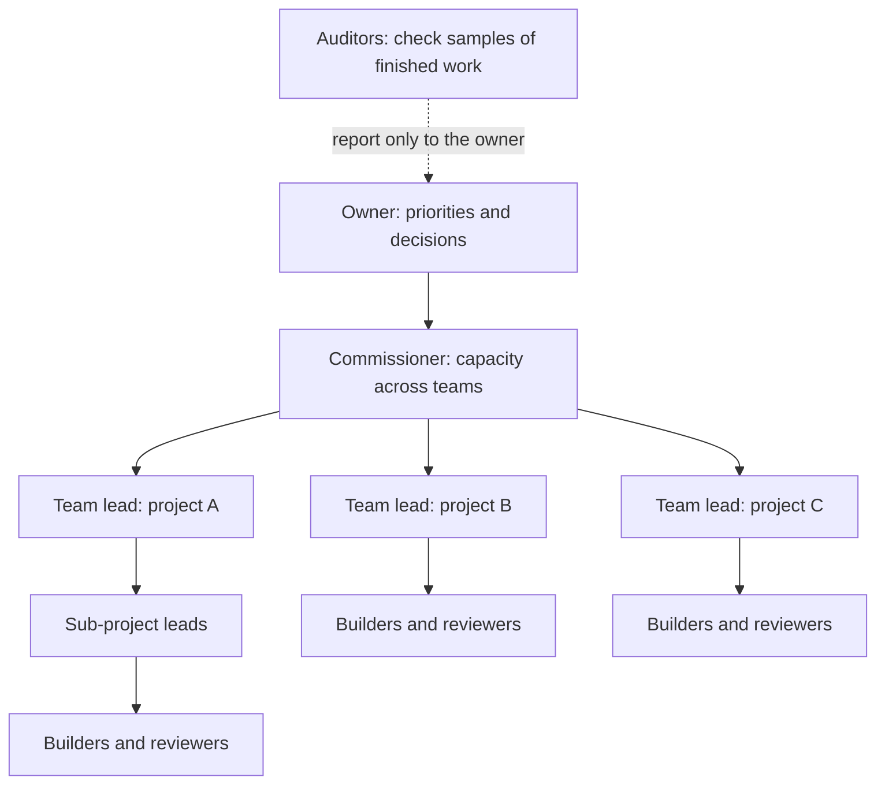
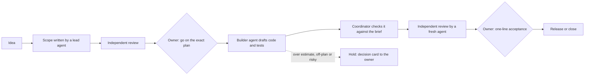

# Agent Dispatch Dashboard (ADD)

**One person, several AI teams, many builds at once.** ADD is the framework and the messaging system that let Claude and OpenAI agents work as organized teams. The owner manages decisions instead of relaying messages between chats.

I designed ADD and run it as its product owner. AI agents plan, build and review the work, and pass it to each other. People approve the decisions that carry risk, and every step leaves a record. This repository is a public overview: the working system and its records stay private because they run real business work.

## The problem

Most people build with AI by copying and pasting between chat windows. A plan goes from one chat into another, the results come back, then the review comments go back again. **The person is the messaging system.**

That works for one project. With several related streams running at once, the person becomes the bottleneck: too many chats, too much relaying and too much to keep track of. That's where I kept hitting my own limit.

AI agents also drift when left alone. They skip steps, review their own work, overrun estimates and lose track of what was decided.

## The idea

ADD replaces the person in the middle with an organization.

- **Automated messaging.** Agents hand work to each other through ADD's message system, not through a person. Each message records who sent it, who it's for, which conversation it belongs to and which files it refers to. ADD routes it to the right role and starts the next agent. Nobody copies and pastes.
- **A framework every agent follows.** Clear roles, written plans, independent review and fixed rules for when work comes back to a person. Every agent knows its lane, so teams keep running without someone watching every message.
- **Only decisions reach the owner.** The owner sees one short list of decisions across all teams, answers them, and the work carries on.

**The goal:** five teams working on independent projects at the same time, each with several sub-projects, run by one person. The gain isn't one project going faster. It's running builds in parallel that a single person couldn't otherwise manage.

## How the teams are organized

- **The owner** sets priorities and answers decision cards from one screen that covers every team.
- **The Commissioner** gives each team builders and reviewers from the AI accounts available, watches usage, and flags when more capacity is needed. It also studies what works, such as which models, settings and instructions lead to fewer review rounds, so each new project gets easier.
- **Team leads** run one project each. They turn goals into plans, run their sub-projects, and never see other teams' work. Their one line of communication out is the Commissioner.
- **Builders and reviewers** are fresh agents for each job. A reviewer never checks its own work.
- **Auditors** check a sample of finished work every night and report only to the owner.

## How a piece of work moves

- **Approvals bind to an exact version.** A "go" covers one specific revision of a plan, identified by a content hash. If the plan changes, it needs a new go.
- **No one reviews their own work.** Reviews come from a fresh agent session that didn't write or check the work. Disputed blockers go to judges from two different model providers.
- **Drift comes back to a person.** Work that runs well over its estimate, changes its goal, weakens a test or reaches outside its limits is held automatically and sent to the owner as a decision card.
- **Autonomy is earned.** A kind of work needs less oversight only after 10 accepted results in a row with no problems found afterwards, and with the owner's yes. A single serious miss moves it back automatically.
- **The owner's attention goes to decisions.** A daily digest covers what moved, what's waiting on whom and what stalled.

## What's under the hood

| Layer | What it does |
| --- | --- |
| **Message system** | Every message names its sender, recipient, conversation and linked files. ADD routes it to a registered role and starts the next agent. Each reply carries a structured result and says who acts next. |
| **Decision records** | Every change records who made it, what changed and why. A repeated request returns its original receipt instead of applying twice, so a crashed agent can retry safely. |
| **Who may do what** | A database authorization layer (PostgreSQL) with rules on every row. Each role sees only its own data and changes it only through fixed, checked commands. A built-in self-check reports any permission or structure problem. |
| **Sealed workspaces** | Each agent run is a capped process with limits on processor, memory, disk, process count and run time, and it can be stopped whole. All of ADD is capped below a fixed share of the machine. |
| **Network wall** | Agents reach the internet only through a proxy that allows approved destinations and can cut a connection mid-run. |
| **Code hand-out** | Agents never touch the real repository. They get a checked, size-limited copy of the files a task needs. Bringing work back is a separate, reviewed step. |
| **Secrets** | Keys and sign-ins never pass through a chat or a document. A person places them directly, and each has a written replacement procedure. |
| **Owner screens** | A web app (Python, Starlette) built around one question: what needs me? Colours and fonts live in one theme file, so the look can change without touching the screens. |

## How I know it works

- **Tests come with every piece.** For example, the first two database pieces passed 2,279 automated checks, including checks that are meant to be refused, such as one role reading another's data.
- **The tests are tested too.** The tests also run against deliberately broken copies of the code (mutation testing), and every planted fault must be caught. Server safety checks are proven the same way: switch one off and confirm the step then refuses.
- **Changes are staged and checked.** Each server change runs as a reviewed script inside an approved time window. It snapshots the protected parts of the server before and after, and it stops itself before changing anything if a check fails. Each database piece ships with an undo that removes exactly that piece. The machine is shared with another business application, and that application always comes first.
- **Approval paths are tested.** For example, a test confirmed that only an answer from the owner's own login counts, and that automated tools can't reach the owner's decision list.

## Where it stands (November 2026)

The first version of ADD was a message-based coordinator that routed work between Claude and OpenAI agents without copy-and-paste. It ran across hundreds of recorded conversations for software, research and documentation. It proved the approach, and it showed where real controls were needed.

Version 2 rebuilds it as a platform with those controls built in. It's being built with its own framework. Until its new message system is live, I'm still relaying some messages by hand, which is exactly the bottleneck it's built to remove.

| Part | Status |
| --- | --- |
| Server foundation and its safety checks | Done |
| Authorization layer (who may do what) | Done |
| Database pieces (records, people and accounts, settings…) | In progress: first two accepted |
| Runtime core (sealed workspaces, network wall, code hand-out) | In progress: first piece installed |
| Operating rulebook and decision queue (early version) | In use |
| Owner screens | First version built on sample data |
| Message system and decision queue on the new platform | Planned, with a reviewed plan |
| Reviews, releases, usage tracking and auditing | Planned, with reviewed plans |
| Switch-over from version 1 | Planned |

## What this project shows

- **Organization design for AI work:** a team structure, messaging system and rules that let one person direct several AI teams at once.
- **AI product ownership:** turning a messy, multi-chat workflow into an operating model with clear roles, decision rights, acceptance criteria and measures (review rounds, time to acceptance, findings, and usage by role and account).
- **Controls you can audit:** separation of duties, least privilege, approvals tied to exact versions, and a full record of every change. These are the habits of regulated industries, applied to AI agents.
- **Multi-model orchestration:** Claude and OpenAI models in defined roles, with cross-checking between them.
- **Quality discipline:** independent review, mutation testing, staged changes and plain-English reporting for non-technical readers.

## Tech

Python (Starlette, Jinja2) · PostgreSQL 18 · Linux service management (systemd) · Claude and Claude Code (Anthropic) · GPT and Codex (OpenAI) · GitHub · Notion

---

Built by Aaron, a data and analytics professional with a background in financial services, working on AI-run product development.
