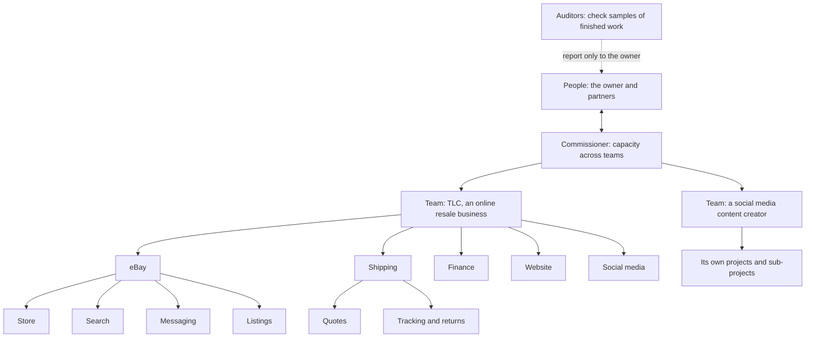
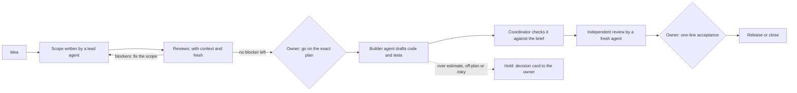

# Agent Dispatch Dashboard (ADD)

**A few people, several AI teams, many builds at once.** ADD is a shared workspace where a small leadership group works with organized teams of AI agents (Claude and OpenAI), held together by a framework and an automated messaging system. People manage decisions instead of relaying messages between chats.

The message loop is the engine. The screens on top are what make ADD different: one place where people and AI agents from several model families work on the same projects together.

I designed ADD and run it as its product owner. AI agents plan, build and review the work, and pass it to each other. People approve the decisions that carry risk, and every step leaves a record. This repository is a public overview: the working system and its records stay private because they run real business work.

## The problem

Most people build with AI by copying and pasting between chat windows. A plan goes from one chat into another, the results come back, then the review comments go back again. **The person is the messaging system.**

That works for one project. With several related streams running at once, the person becomes the bottleneck: too many chats, too much relaying and too much to keep track of. That's where I kept hitting my own limit. Bringing in a second person makes it worse: they can't see your chats, so everything has to be forwarded or explained again.

AI agents also drift when left alone. They skip steps, review their own work, overrun estimates and lose track of what was decided.

## The idea

ADD replaces the person in the middle with an organization.

- **Automated messaging.** Agents hand work to each other through ADD's message system, not through a person. Each message records who sent it, who it's for, which conversation it belongs to and which files it refers to. ADD routes it to the right role and starts the next agent. Nobody copies and pastes.
- **A framework every agent follows.** Clear roles, written plans, independent review and fixed rules for when work comes back to a person. Every agent knows its lane, so teams keep running without someone watching every message.
- **Deeper reviews, automatically.** Because agents message each other, a scope can go through several reviewers and several rounds of back-and-forth without anyone opening a window. Done by hand, that's six review chats for one person to keep open.
- **A shared workspace for several people.** Partners work alongside the owner like a leadership team. They can talk with the Commissioner and with any team's lead, see the same screens, help shape scopes, and answer decisions in their own name, without anyone forwarding chats to them.
- **One conversation across accounts and models.** A person can talk with agents on different accounts and different model providers in the same chat. Each agent session carries its own context, so someone who opens a team's lead chat picks up its history immediately, instead of starting over in a blank chat.
- **Only decisions reach people.** Each person sees one short list of the decisions that are theirs, across all teams, answers them, and the work carries on.

**The goal:** a few people pushing every part of a business forward at once without getting stuck. For an online resale business, that means its eBay store, shipping, finance, website and social media all moving in parallel, with a second business alongside it. The first milestone is three people and at least five projects running at once, from ADD's own server. The gain isn't one project going faster. It's running builds in parallel that a small group couldn't otherwise manage.

## How the teams are organized

Every box is a level with its own lead chat. Builders and reviewers are brought in for each job wherever the work is.

- **Teams, projects and sub-projects.** Work nests as deep as it needs to. TLC, an online resale business, is one team. Its projects are eBay, shipping, finance, its website and social media, and each one breaks down further:
  - **eBay** has sub-projects for the store, search, messaging and listings.
  - **Shipping** will take each sale from eBay, or any other sales channel added later, and show the best quotes from Shippo and from the channel. It then tracks every parcel through transit and delivery to the end of its return window.

  A second team, a social media content creator, has its own projects and sub-projects at similar depth. Every level has the same kind of view: a chat with that level's lead, the decisions that belong there, and the levels beneath. What's shown gets more specific the further down you go.
- **People work as a leadership team.** The owner and partners set priorities, talk with the Commissioner and with any team's lead, and answer decision cards from screens that cover every team. Partners can work in the same screens as the owner. The owner account keeps a few extra permissions for the riskiest calls, such as access, money and credentials. Which AI account runs a lead chat is a practical setting that can change.
- **The Commissioner** gives each team builders and reviewers from the AI accounts available, watches usage, and flags when more capacity is needed. It also studies what works, such as which models, settings and instructions lead to fewer review rounds, so each new project gets easier.
- **Leads** run one level each. A team lead turns goals into projects and plans and never sees other teams' work; its one line of communication out is the Commissioner. Project and sub-project leads report to the level above them.
- **Builders and reviewers** are fresh agents for each job. A reviewer never checks its own work.
- **Auditors** check a sample of finished work every night and report only to the owner.

## How a piece of work moves

- **Problems are fixed in the plan, not the build.** Each scope gets two kinds of review. One reviewer knows the project; a fresh one sees only the scope and catches what familiarity hides. Reviewers come from different model providers. The lead answers every numbered finding, fixing it or disputing it with evidence, and re-checks run until no blocker is left. If three rounds don't settle it, a person decides. Builds start from a cleaner plan, and fewer problems surface late.
- **The limit is usage, not attention.** How many reviewers and rounds a scope gets depends on the weekly usage limits of the AI accounts, which the Commissioner shares out across teams. It doesn't depend on how many windows a person can juggle.
- **Approvals bind to an exact version.** A "go" covers one specific revision of a plan, identified by a content hash. If the plan changes, it needs a new go.
- **No one reviews their own work.** Reviews come from a fresh agent session that didn't write or check the work. Disputed blockers go to judges from two different model providers.
- **Drift comes back to a person.** Work that runs well over its estimate, changes its goal, weakens a test or reaches outside its limits is held automatically and sent to the owner as a decision card.
- **Autonomy is earned.** A kind of work needs less oversight only after 10 accepted results in a row with no problems found afterwards, and with the owner's yes. A single serious miss moves it back automatically.
- **The owner's attention goes to decisions.** A daily digest covers what moved, what's waiting on whom and what stalled.

## What's under the hood

| Layer | What it does |
| --- | --- |
| **Message system** | Every message names its sender, recipient, conversation and linked files. ADD routes it to a registered role and starts the next agent. Each reply carries a structured result and says who acts next. |
| **Decision records** | Every change records who made it, what changed and why. A repeated request returns its original receipt instead of applying twice, so a crashed agent can retry safely. |
| **Who may do what** | A database authorization layer (PostgreSQL) with rules on every row. Each role sees only its own data and changes it only through fixed, checked commands. A built-in self-check reports any permission or structure problem. |
| **Sealed workspaces** | Each agent run is a capped process with limits on processor, memory, disk, process count and run time, and it can be stopped whole. All of ADD is capped below a fixed share of the machine. |
| **Network wall** | Agents reach the internet only through a proxy that allows approved destinations and can cut a connection mid-run. |
| **Code hand-out** | Agents never touch the real repository. They get a checked, size-limited copy of the files a task needs. Bringing work back is a separate, reviewed step. |
| **Secrets** | Keys and sign-ins never pass through a chat or a document. A person places them directly, and each has a written replacement procedure. |
| **Shared screens** | The web app (Python, Starlette) where people and agents work together. There's one view for each team, project and sub-project, with its lead chat and the decisions that belong there, built around one question: what needs me? Colours and fonts live in one theme file, so the look can change without touching the screens. |

## How I know it works

- **Tests come with every piece.** For example, the first two database pieces passed 2,279 automated checks, including checks that are meant to be refused, such as one role reading another's data.
- **The tests are tested too.** The tests also run against deliberately broken copies of the code (mutation testing), and every planted fault must be caught. Server safety checks are proven the same way: switch one off and confirm the step then refuses.
- **Changes are staged and checked.** Each server change runs as a reviewed script inside an approved time window. It snapshots the protected parts of the server before and after, and it stops itself before changing anything if a check fails. Each database piece ships with an undo that removes exactly that piece. The machine is shared with another business application, and that application always comes first.
- **Approval paths are tested.** For example, a test confirmed that only an answer from the owner's own login counts, and that automated tools can't reach the owner's decision list.

## Where it stands (November 2026)

The first version of ADD was a working message system: code that routed work between Claude and OpenAI agents, and started each next agent, without copy-and-paste. It ran across hundreds of recorded conversations for software, research and documentation. It proved the approach, and it showed where real controls were needed.

Version 2 rebuilds it as a platform with those controls built in, using its own framework. Version 1 is switched off while that happens, so until the new message system is live I'm relaying messages by hand again. That's exactly the bottleneck ADD exists to remove.

| Part | Status |
| --- | --- |
| Server foundation and its safety checks | Done, including a 24-hour load baseline |
| Authorization layer (who may do what) | Done |
| Database pieces (records, people and accounts, settings, work records…) | In progress: three accepted; a fourth (work records) passed review; the first piece passed its full test on the real server and is now installed on ADD's development database, leaving the live app untouched |
| Runtime core (sealed workspaces, network wall, code hand-out) | In progress: the first piece's install stage is done on the server; five more are accepted as tested drafts and wait for its second stage, including the server side of session transcripts and notes |
| Operating rulebook and decision queue (early version) | In use |
| Shared screens | First version built on sample data |
| Shared workspace for several people, with chats across accounts and models | Designed and in the first screens. First milestone: three people and five projects at once |
| Message system and decision queue on the new platform | Planned, with a reviewed plan |
| Reviews, releases, usage tracking and auditing | Planned, with reviewed plans |
| Switch-over from version 1 | Planned |

## What this project shows

- **Organization design for AI work:** a team structure, messaging system and rules that let a small group of people direct several AI teams at once, in one shared workspace with the agents.
- **AI product ownership:** turning a messy, multi-chat workflow into an operating model with clear roles, decision rights, acceptance criteria and measures (review rounds, time to acceptance, findings, and usage by role and account).
- **Controls you can audit:** separation of duties, least privilege, approvals tied to exact versions, and a full record of every change. These are the habits of regulated industries, applied to AI agents.
- **Multi-model orchestration:** Claude and OpenAI models in defined roles, with cross-checking between them.
- **Quality discipline:** layered independent review that settles problems before the build, mutation testing, staged changes and plain-English reporting for non-technical readers.

## Tech

Python (Starlette, Jinja2) · PostgreSQL 18 · Linux service management (systemd) · Claude and Claude Code (Anthropic) · GPT and Codex (OpenAI) · GitHub · Notion

---

Built by Aaron, a data and analytics professional with a background in financial services, working on AI-run product development.
